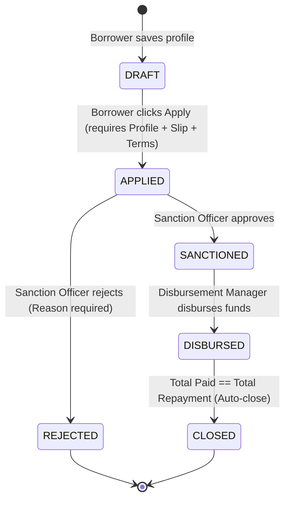
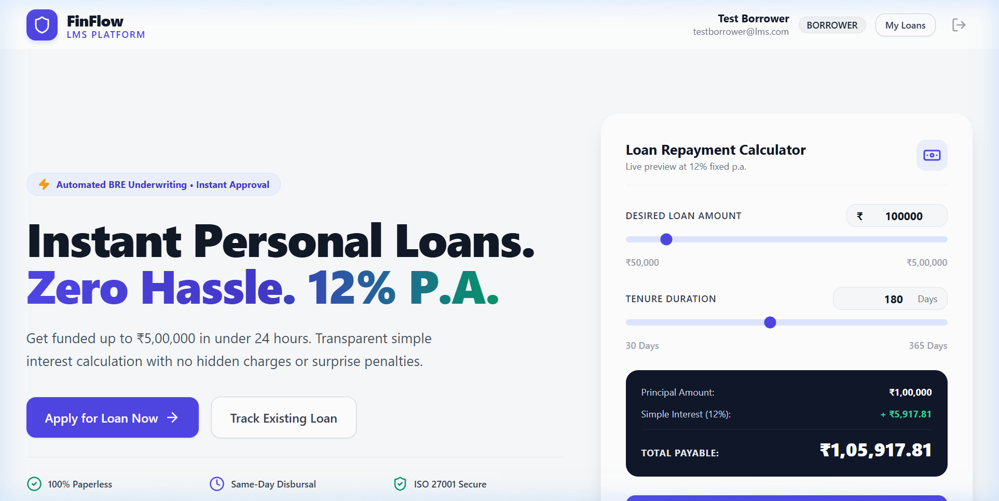
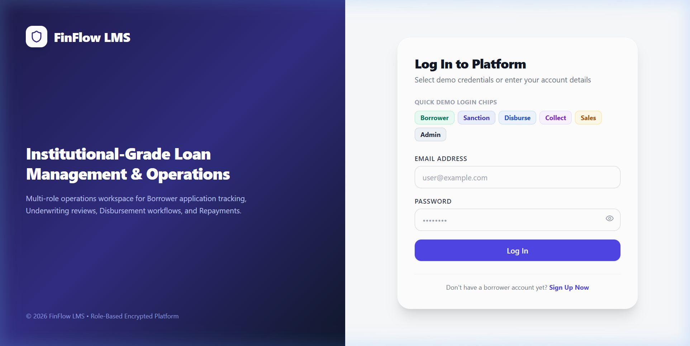
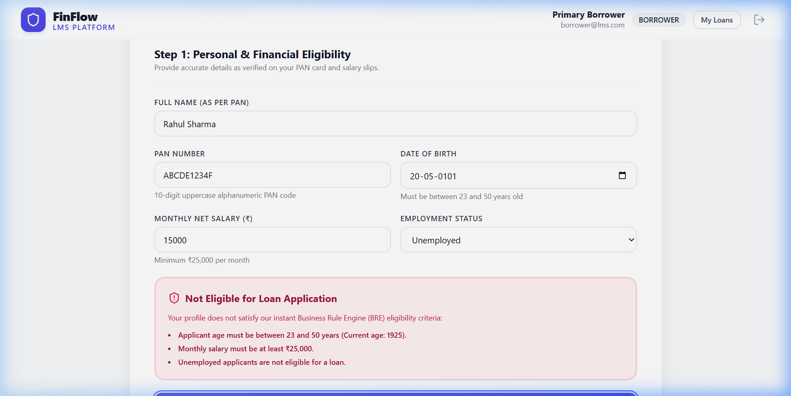
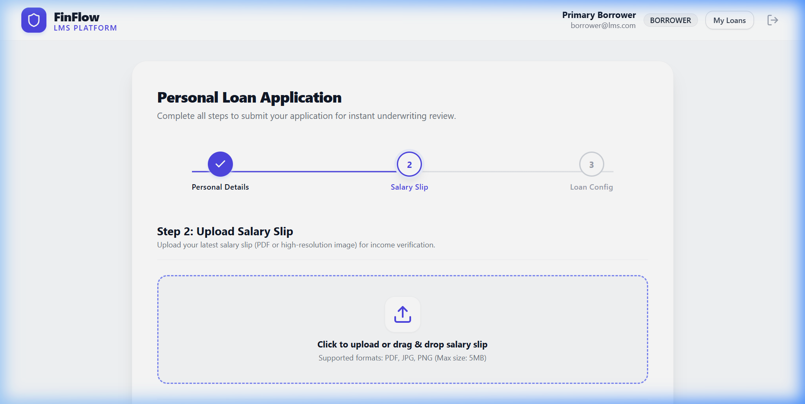
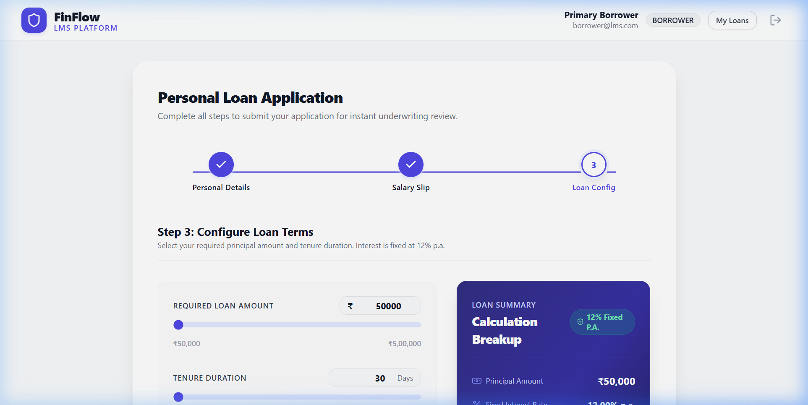
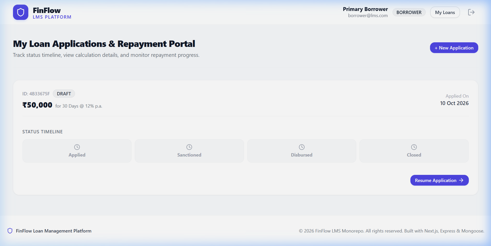
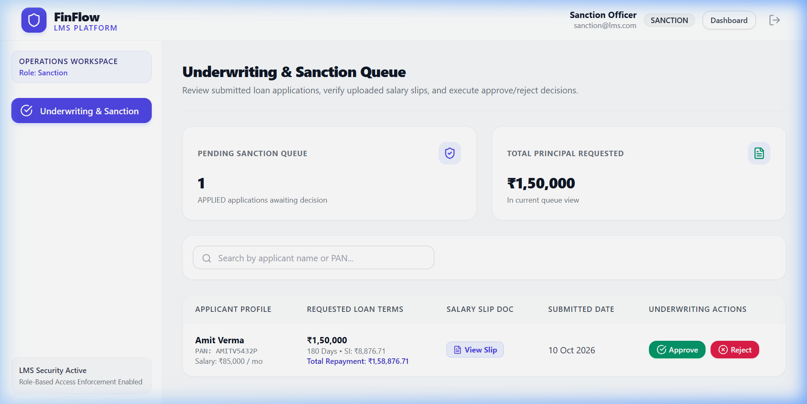
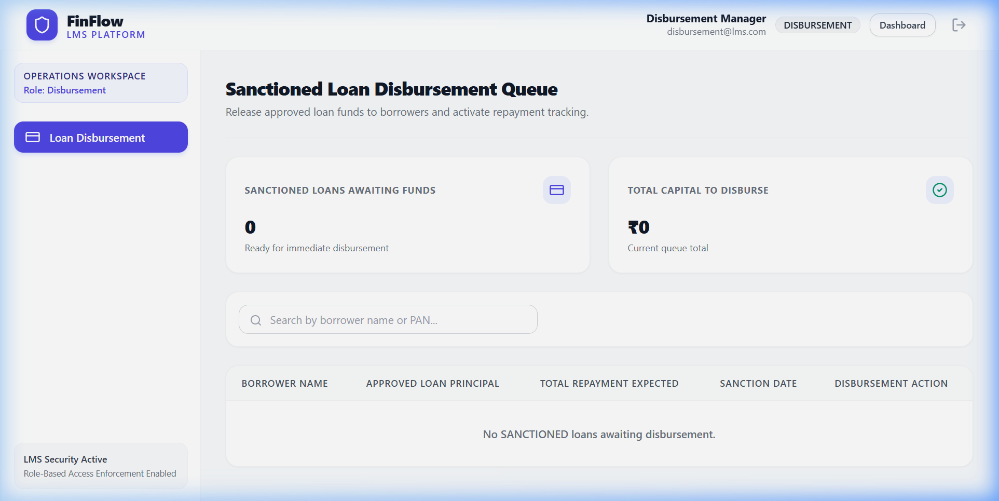
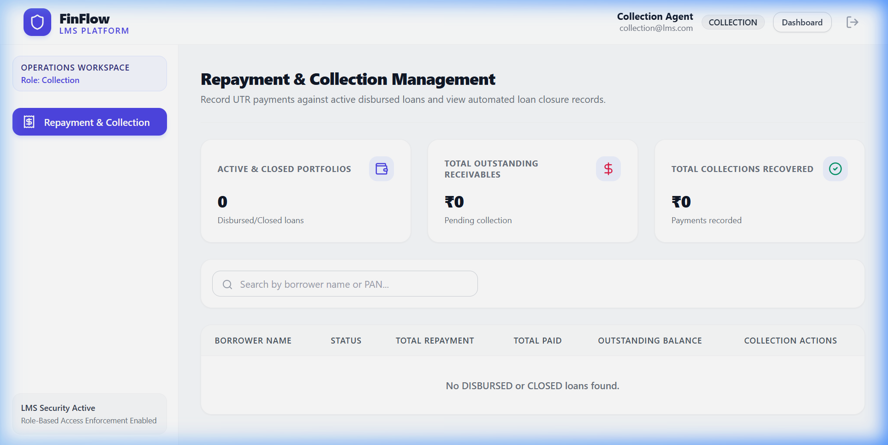

# FinFlow LMS — Monorepo Loan Management System

FinFlow LMS is an institutional-grade, monorepo Loan Management System designed for digital lending platforms. Borrowers apply through a 3-step paperless portal featuring instant server-side Business Rule Engine (BRE) eligibility verification, while staff executives manage underwriting, disbursement, and repayments on a role-guarded operations dashboard.

---

## 🏗 Expanded Monorepo Directory Tree

```
lms/
├── README.md                           # Monorepo setup guide, credentials, and architectural summary
├── .gitignore                          # Global git exclusion rules (ignores build outputs, secrets & uploaded slips)
├── docs/                               # System documentation directory
│   ├── API.md                          # REST API endpoint table, JSON envelopes, and error status code guide
│   ├── ARCHITECTURE.md                 # System architecture, data model ERD, BRE logic, and state machine specs
│   └── screenshots/                    # UI walkthrough screenshots across 1440px, 768px, and 375px viewports
│       ├── landing_page_1440.png       # Hero landing page with live simple interest EMI calculator
│       ├── login_page_1440.png         # Split layout authentication page with one-click demo chips
│       ├── bre_rejection_card.png      # Instant BRE eligibility failure alert card with plain-language fix hints
│       ├── step2_salary_slip.png       # Income verification drag-and-drop file uploader
│       ├── step3_loan_config.png       # Tenure & principal sliders with sticky calculation summary panel
│       ├── application_confirmation_modal.png # Final confirmation dialog prior to server submission
│       ├── my_loans_page.png           # Borrower status timeline & repayment progress portal
│       ├── sales_dashboard.png         # Sales lead funnel tracking table with stage chips
│       ├── sanction_dashboard.png      # Underwriting queue with salary slip streaming and approve/reject controls
│       ├── disbursement_dashboard.png  # Sanctioned loan fund release management interface
│       └── collection_dashboard.png    # Repayment recorder with UTR entry, overpayment guard & auto-close
├── server/                             # Express.js + TypeScript REST API backend
│   ├── package.json                    # Backend dependencies & script definitions
│   ├── tsconfig.json                   # Strict TypeScript compiler configuration (strict: true)
│   ├── .env.example                    # Sample backend environment configuration template
│   ├── uploads/                        # Salary slips non-public storage directory
│   │   └── .gitkeep                    # Directory preservation placeholder for git
│   └── src/                            # Backend TypeScript source code
│       ├── server.ts                   # Boot script: connects database and initializes HTTP listener
│       ├── app.ts                      # Express application setup, security middleware, and route mounting
│       ├── config/                     # Configuration loaders
│       │   ├── env.ts                  # Zod-validated environment variable loader
│       │   └── db.ts                   # Mongoose MongoDB connection initializer
│       ├── constants/                  # Domain constants & state machine maps
│       │   ├── roles.ts                # System role string enum definitions
│       │   ├── loanStatus.ts           # Loan status enum and allowed state transitions map
│       │   └── loanConfig.ts           # Interest rate (12%), tenure boundaries, and BRE limits
│       ├── models/                     # Mongoose data schemas and indexes
│       │   ├── User.model.ts           # User authentication schema with email unique index
│       │   ├── Loan.model.ts           # Loan application schema with compound (status, createdAt) index
│       │   └── Payment.model.ts        # Repayment payment schema with uppercase unique UTR index
│       ├── modules/                    # Feature modules (controller, service, routes, schema)
│       │   ├── auth/                   # Public user registration & authentication handling
│       │   ├── borrower/               # Borrower application wizard, draft resume, and personal loans
│       │   ├── sales/                  # Borrower funnel lead tracking aggregation
│       │   ├── sanction/               # Underwriting approval & rejection decision workflows
│       │   ├── disbursement/           # Sanctioned fund release workflow
│       │   ├── collection/             # Repayment recording, duplicate UTR prevention, and auto-close
│       │   └── shared/                 # Authenticated salary slip file streaming controller
│       ├── middleware/                 # Middleware chain
│       │   ├── authenticate.ts         # JWT token verification and user context extraction
│       │   ├── authorize.ts            # Role-Based Access Control (RBAC) middleware
│       │   ├── validate.ts             # Zod schema validation middleware
│       │   ├── upload.ts               # Multer file upload filter for salary slips
│       │   └── errorHandler.ts         # Centralized error envelope formatter
│       ├── services/                   # Pure business logic services
│       │   ├── bre.service.ts          # Server-authoritative Business Rule Engine pure function
│       │   └── loanCalculator.ts       # Simple interest formula and roundMoney helper
│       ├── utils/                      # Helper utilities
│       │   ├── AppError.ts             # Custom operational error class supporting error codes
│       │   ├── asyncHandler.ts          # Async route wrapper for exception handling
│       │   ├── jwt.ts                  # JWT signing and verification helpers
│       │   └── regex.ts                # Safe regex character escaping helper
│       ├── scripts/                    # Database management scripts
│       │   └── seed.ts                 # Idempotent database seed script
│       └── __tests__/                  # Backend unit tests
│           ├── bre.test.ts             # Vitest unit tests for BRE eligibility edge cases
│           ├── loanCalculator.test.ts  # Vitest unit tests for simple interest calculations
│           └── moneyDriftAndClose.test.ts # Vitest unit tests for roundMoney & zero float-drift closing
└── client/                             # Next.js (App Router) + TypeScript frontend
    ├── package.json                    # Frontend dependencies & script definitions
    ├── tsconfig.json                   # Strict TypeScript configuration with @/* path aliases
    ├── next.config.mjs                 # Next.js framework configuration
    ├── tailwind.config.ts              # Tailwind CSS configuration with design system tokens
    ├── postcss.config.js               # PostCSS processor configuration
    ├── .env.example                    # Sample client environment configuration template
    └── src/                            # Frontend TypeScript source code
        ├── app/                        # Next.js App Router pages and layouts
        │   ├── layout.tsx              # Root HTML layout with Plus Jakarta Sans font & Toast provider
        │   ├── page.tsx                # Fintech landing page with EMI preview, feature rows & FAQ
        │   ├── globals.css             # Tailwind base layer, theme variables & tabular-nums styling
        │   ├── (auth)/                 # Authentication pages
        │   │   ├── login/page.tsx      # Split-layout login page with quick demo login chips
        │   │   └── signup/page.tsx     # Borrower account creation page
        │   ├── (borrower)/             # Borrower portal routes
        │   │   ├── apply/              # Multi-step application wizard shell
        │   │   │   ├── layout.tsx      # Horizontal progress stepper layout
        │   │   │   ├── personal-details/page.tsx # Step 1: Personal profile & instant BRE check
        │   │   │   ├── salary-slip/page.tsx # Step 2: Income document drag & drop uploader
        │   │   │   └── loan-config/page.tsx # Step 3: Tenure/principal sliders & confirmation
        │   │   └── my-loans/page.tsx   # Borrower status timeline & repayment progress portal
        │   ├── dashboard/              # Operations workspace routes
        │   │   ├── layout.tsx          # Staff dashboard shell with sidebar & topbar
        │   │   ├── page.tsx            # Role-based workspace redirect router
        │   │   ├── sales/page.tsx      # Sales lead funnel tracking table & stats
        │   │   ├── sanction/page.tsx   # Underwriting queue with salary slip preview & reject modal
        │   │   ├── disbursement/page.tsx # Sanctioned fund release management page
        │   │   └── collection/page.tsx # Repayment manager with UTR entry & auto-close state
        │   ├── unauthorized/page.tsx   # HTTP 403 access denied guard page
        │   └── not-found.tsx           # HTTP 404 page not found view
        ├── components/                 # Reusable UI component library
        │   ├── ui/                     # Primitives (Button, Input, Select, Card, Badge, Modal, Table, Slider, Stepper, Skeleton, Spinner, EmptyState)
        │   ├── layout/                 # Layout wrappers (Navbar, Sidebar, PageHeader, Footer)
        │   ├── borrower/               # Borrower components (PersonalDetailsForm, SalarySlipUploader, LoanSummaryPanel)
        │   └── dashboard/              # Dashboard components (StatCard, RejectModal, PaymentForm, PaymentHistory)
        ├── lib/                        # Client utilities
        │   ├── api.ts                  # Axios client wrapper with JWT bearer interceptors
        │   ├── auth.ts                 # Local storage authentication token helpers
        │   ├── bre.ts                  # Client-side BRE pure function mirror
        │   ├── loanCalculator.ts       # Client simple interest calculation mirror
        │   ├── format.ts               # Currency (en-IN) and date formatting helpers
        │   └── validators.ts           # Zod form validation schemas
        ├── context/                    # React Contexts
        │   └── AuthContext.tsx         # User authentication state provider
        ├── middleware.ts               # Next.js route-level protection middleware
        └── types/                      # Frontend TypeScript interface & enum definitions
```

---

## ⚙️ Prerequisites & Installation

### System Prerequisites
- **Node.js**: `v20.x` or higher
- **npm**: `v10.x` or higher
- **MongoDB**: Local MongoDB server running on `mongodb://127.0.0.1:27017` OR MongoDB Atlas connection URI.

---

## 🔑 Environment Variables Configuration

### Backend Environment (`server/.env.example`)
```env
PORT=5000
NODE_ENV=development
MONGODB_URI=mongodb://127.0.0.1:27017/lms
JWT_SECRET=change-me-super-secret-jwt-key-lms-2026
JWT_EXPIRES_IN=1d
CLIENT_URL=http://localhost:3000
```

### Frontend Environment (`client/.env.example`)
```env
NEXT_PUBLIC_API_URL=http://localhost:5000/api/v1
```

---

## 🚀 Quick Setup & Local Execution

### 1. Backend API Setup & Seeding
```bash
# Navigate to server directory
cd server

# Install dependencies
npm install

# Run database seed script (Populates core roles & demo loans)
npm run seed

# Execute unit tests
npm run test

# Run TypeScript typecheck
npm run typecheck

# Start backend server in development mode
npm run dev
```

### 2. Frontend Setup
```bash
# In a new terminal, navigate to client directory
cd client

# Install dependencies
npm install

# Run TypeScript typecheck
npm run typecheck

# Start Next.js development server
npm run dev
```

Once running:
- **Frontend Web Portal**: [http://localhost:3000](http://localhost:3000)
- **Backend API Server**: [http://localhost:5000/api/v1](http://localhost:5000/api/v1)
- **Backend Health Check**: [http://localhost:5000/health](http://localhost:5000/health)

---

## 👤 Seeded Credentials Table

Run `npm run seed` in the `server` directory to populate the database with default accounts for each role:

| Role | Email | Password | Operations Workspace Access |
|---|---|---|---|
| **ADMIN** | `admin@lms.com` | `Admin@123` | Full System Access & All Modules |
| **SALES** | `sales@lms.com` | `Sales@123` | Sales Lead Funnel Tracking (`/dashboard/sales`) |
| **SANCTION** | `sanction@lms.com` | `Sanction@123` | Underwriting Review & Approve/Reject (`/dashboard/sanction`) |
| **DISBURSEMENT** | `disbursement@lms.com` | `Disburse@123` | Fund Disbursement Release Queue (`/dashboard/disbursement`) |
| **COLLECTION** | `collection@lms.com` | `Collect@123` | Repayments & UTR Entry (`/dashboard/collection`) |
| **BORROWER** | `borrower@lms.com` | `Borrower@123` | Borrower Application Portal (`/apply/*`, `/my-loans`) |

---

## 🔄 Loan Status State Machine

Loan status transitions follow a deterministic state machine enforced server-side using atomic conditional updates (`findOneAndUpdate({ _id, status: EXPECTED })`):



- **DRAFT**: Created when a borrower completes personal details.
- **APPLIED**: Borrower configures tenure/amount and submits application.
- **SANCTIONED**: Sanction Officer approves the application.
- **REJECTED**: Sanction Officer rejects the application (requires written reason).
- **DISBURSED**: Disbursement Manager marks funds as disbursed.
- **CLOSED**: Automatically triggered when `outstandingBalance` reaches ₹0.00 via payments.

---

## 🔐 Role × Module Access Matrix

| Module / Endpoint | ADMIN | SALES | SANCTION | DISBURSEMENT | COLLECTION | BORROWER |
|---|:---:|:---:|:---:|:---:|:---:|:---:|
| `/sales/*` | ✅ | ✅ | ❌ | ❌ | ❌ | ❌ |
| `/sanction/*` | ✅ | ❌ | ✅ | ❌ | ❌ | ❌ |
| `/disbursement/*` | ✅ | ❌ | ❌ | ✅ | ❌ | ❌ |
| `/collection/*` | ✅ | ❌ | ❌ | ❌ | ✅ | ❌ |
| `/borrower/*` | ✅ | ❌ | ❌ | ❌ | ❌ | ✅ (Own Only) |
| `/loans/:id/salary-slip` | ✅ | ❌ 403 | ✅ | ✅ | ❌ 403 | ✅ (Own Only) |

---

## 📄 Documentation Links
- [REST API Specifications (docs/API.md)](docs/API.md)
- [Architecture & Data Model Specs (docs/ARCHITECTURE.md)](docs/ARCHITECTURE.md)

---

## 📸 Application Screenshots

### Landing Page & Interactive Calculator


### Authentication & Quick Demo Login Chips


### Step 1: BRE Instant Eligibility Evaluation & Failure Alert Card


### Step 2: Salary Slip Income Verification Uploader


### Step 3: Loan Terms Configuration & Confirmation Dialog


### Borrower Status Timeline Portal (`/my-loans`)


### Underwriting & Sanction Queue Dashboard (`/dashboard/sanction`)


### Loan Disbursement Queue Dashboard (`/dashboard/disbursement`)


### Repayment & Collection Manager (`/dashboard/collection`)

