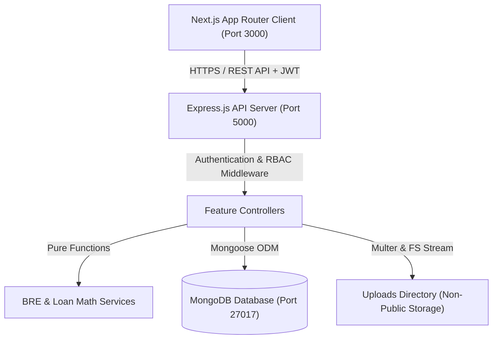
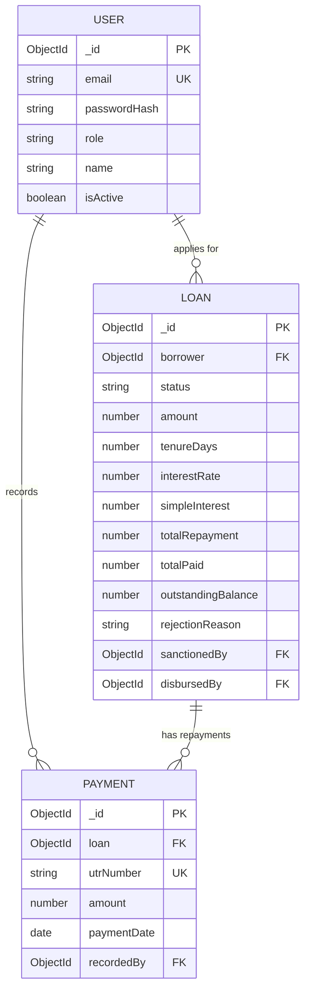
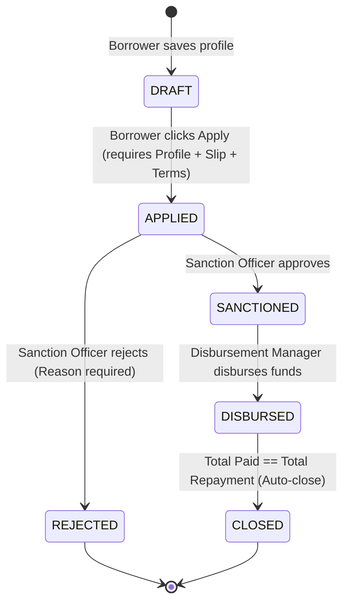

# FinFlow LMS — System Architecture & Design Decisions

## 1. System Overview

FinFlow LMS is engineered as a secure, multi-tier monorepo architecture separating the Next.js client from the RESTful Node.js / Express backend.



---

## 2. Data Model & Entity Relationship

### Schema Specifications

#### **User Entity** (`users` collection)
- `_id`: ObjectId (Primary Key)
- `name`: String, required, trimmed
- `email`: String, required, unique, lowercase, trimmed — **Index: Unique**
- `passwordHash`: String, required, `select: false`
- `role`: String Enum (`ADMIN`, `SALES`, `SANCTION`, `DISBURSEMENT`, `COLLECTION`, `BORROWER`), default: `BORROWER`
- `isActive`: Boolean, default: `true`
- `createdAt`, `updatedAt`: Date timestamps

#### **Loan Entity** (`loans` collection)
- `_id`: ObjectId (Primary Key)
- `borrower`: ObjectId (ref `User`), required — **Index: Single Field**
- `personalDetails`: Embedded Document (`fullName`, `pan`, `dob`, `monthlySalary`, `employmentMode`)
- `salarySlip`: Embedded Document (`originalName`, `storedName`, `path`, `mimeType`, `size`)
- `amount`: Number, default: 50,000
- `tenureDays`: Number, default: 30
- `interestRate`: Number, default: 12 (Fixed 12% p.a.)
- `simpleInterest`: Number, default: 0
- `totalRepayment`: Number, default: 0
- `totalPaid`: Number, default: 0
- `outstandingBalance`: Number, default: 0
- `status`: String Enum (`DRAFT`, `APPLIED`, `SANCTIONED`, `REJECTED`, `DISBURSED`, `CLOSED`), default: `DRAFT` — **Index: Single Field**
- `rejectionReason`: String, optional
- `sanctionedBy`: ObjectId (ref `User`), optional
- `sanctionedAt`: Date, optional
- `disbursedBy`: ObjectId (ref `User`), optional
- `disbursedAt`: Date, optional
- `closedAt`: Date, optional
- `createdAt`, `updatedAt`: Date timestamps
- **Compound Index**: `{ status: 1, createdAt: -1 }`

#### **Payment Entity** (`payments` collection)
- `_id`: ObjectId (Primary Key)
- `loan`: ObjectId (ref `Loan`), required — **Index: Single Field**
- `utrNumber`: String, required, uppercase, trimmed — **Index: Unique**
- `amount`: Number, required, min: 0.01
- `paymentDate`: Date, required
- `recordedBy`: ObjectId (ref `User`), required
- `createdAt`, `updatedAt`: Date timestamps

### Entity Relationship Diagram (ERD)



---

## 3. Status State Machine

The loan application lifecycle strictly follows a deterministic state machine on the server.



### Transition Matrix & Audit Log Fields

| From Status | To Status | Triggered By | Required Conditions & Validations | Fields Written |
|---|---|---|---|---|
| `DRAFT` | `APPLIED` | Borrower | Completed profile + uploaded slip + valid amount/tenure terms | `amount`, `tenureDays`, `interestRate`, `simpleInterest`, `totalRepayment`, `outstandingBalance`, `status: APPLIED` |
| `APPLIED` | `SANCTIONED` | Sanction, Admin | Loan in `APPLIED` status | `status: SANCTIONED`, `sanctionedBy`, `sanctionedAt` |
| `APPLIED` | `REJECTED` | Sanction, Admin | Loan in `APPLIED` status; Non-empty rejection reason ($\ge 5$ chars) | `status: REJECTED`, `rejectionReason` |
| `SANCTIONED` | `DISBURSED` | Disbursement, Admin | Loan in `SANCTIONED` status | `status: DISBURSED`, `disbursedBy`, `disbursedAt` |
| `DISBURSED` | `CLOSED` | Automatic | Payment recorded such that `outstandingBalance == 0` | `status: CLOSED`, `closedAt` |

---

## 4. Business Rule Engine (BRE) Architecture

### Rule Specifications

| Rule Name | Target Field | Validation Logic | Failure Reason Message |
|---|---|---|---|
| `AGE_RESTRICTION` | `dob` | Exact age between 23 and 50 years (calculated relative to present date) | `Applicant age must be between 23 and 50 years` |
| `MIN_SALARY_THRESHOLD` | `monthlySalary` | Net monthly salary $\ge ₹25,000$ | `Monthly salary must be at least ₹25,000` |
| `INVALID_PAN_FORMAT` | `pan` | Matching regex `^[A-Z]{5}[0-9]{4}[A-Z]$` after uppercase normalization | `PAN must be a valid 10-character code matching format ABCDE1234F` |
| `DISALLOWED_EMPLOYMENT` | `employmentMode` | `employmentMode != 'UNEMPLOYED'` | `Unemployed applicants are not eligible for a loan` |

### Authoritative Server & Client Mirror Pattern
- **Server Authoritative**: All BRE evaluations run on the backend (`services/bre.service.ts`). Evaluating rules on the server prevents clients from tampering with requests.
- **Client Mirror**: The frontend mirrors rule logic (`lib/bre.ts`) to provide instant UX feedback before network dispatch.
- **Combined Failure Aggregation**: All rule checks execute independently; if an applicant fails multiple rules, **all failures are aggregated into an array** and returned in a single response, enabling the user to fix all issues at once.

---

## 5. Loan Math & Financial Calculations

### Simple Interest Formula
$$\text{Simple Interest (SI)} = \frac{P \times R \times T}{365 \times 100}$$
$$\text{Total Repayment} = P + \text{SI}$$

Where:
- $P = \text{Principal Amount}$ ($₹50,000$ to $₹5,00,000$)
- $R = \text{Fixed Interest Rate}$ ($12\%$ per annum)
- $T = \text{Tenure in Days}$ ($30$ to $365$ days)

### Money Rounding Helper (`roundMoney`)
All monetary calculations are rounded to 2 decimal places using `roundMoney(val)`:
```typescript
export function roundMoney(val: number): number {
  return Math.round((val + Number.EPSILON) * 100) / 100;
}
```

### Worked Calculation Example
- Principal Amount ($P$): $₹1,00,000$
- Tenure ($T$): $365$ days
- Rate ($R$): $12\%$ p.a.
$$\text{SI} = \frac{100000 \times 12 \times 365}{365 \times 100} = ₹12,000.00$$
$$\text{Total Repayment} = 100000 + 12000 = ₹1,12,000.00$$

---

## 6. Payments & Automatic Closing

1. **Validations**:
   - Loan must be in `DISBURSED` status.
   - UTR number must be non-empty and globally unique.
   - Payment amount $> 0$ and $\le \text{outstandingBalance}$ (Overpayment rejected with HTTP 400 `OVERPAYMENT`).
   - Payment date $\le \text{today}$ and $\ge \text{disbursedAt}$.
2. **Duplicate UTR Handling**:
   - `utrNumber` has a unique MongoDB index.
   - Catching Mongo `E11000` errors maps cleanly to HTTP 409 with `code: DUPLICATE_UTR`.
3. **Atomic Balance Updates & Auto-Close**:
   - `totalPaid` updated to `roundMoney(loan.totalPaid + amount)`.
   - `outstandingBalance` updated to `roundMoney(loan.totalRepayment - newTotalPaid)`.
   - If `outstandingBalance < 0.01`, set `outstandingBalance = 0`, `status = CLOSED`, and `closedAt = new Date()`.

---

## 7. Security Hardening

- **Password Hashing**: `bcryptjs` with cost factor 10. `passwordHash` hidden by default (`select: false`).
- **JWT Authentication**: Signed with 256-bit secret, 1-day expiry. Contains `{ id, email, role, name }`.
- **Privilege Escalation Protection**: Public signup endpoint ignores any `role` in request body and forces `role = BORROWER`.
- **Upload Hardening**: Multer validates mimetype (`pdf`, `jpeg`, `png`) and file extensions. Random filename generation (`salary-slip-<timestamp>-<random>.<ext>`). Files stored outside web root (`server/uploads/`) and streamed via authenticated route (`GET /loans/:id/salary-slip`).
- **Web Security**: `helmet` security headers, CORS restricted to `CLIENT_URL`, `express-rate-limit` on auth routes (100 req/15 min).
- **Regex Injection (ReDoS) Defense**: User search terms sanitized with `escapeRegex()`.

---

## 8. Role-Based Access Control (RBAC) Architecture

RBAC is enforced across four distinct layers:
1. **Next.js Middleware (`middleware.ts`)**: Route-level protection for `/dashboard` and `/apply`.
2. **Layout Guards (`dashboard/layout.tsx`)**: Redirects non-staff (Borrower) users to `/unauthorized`.
3. **Sidebar Filtering (`components/layout/Sidebar.tsx`)**: Displays only module items permitted for the active role.
4. **Backend Authorization (`middleware/authorize.ts`)**: Checks role string embedded in JWT payload. ADMIN bypasses all authorize restrictions. Ownership checks verify borrowers access only their own records.

### Complete Access Control Matrix

| Endpoint / Module | ADMIN | SALES | SANCTION | DISBURSEMENT | COLLECTION | BORROWER |
|---|:---:|:---:|:---:|:---:|:---:|:---:|
| `/sales/*` | ✅ | ✅ | ❌ | ❌ | ❌ | ❌ |
| `/sanction/*` | ✅ | ❌ | ✅ | ❌ | ❌ | ❌ |
| `/disbursement/*` | ✅ | ❌ | ❌ | ✅ | ❌ | ❌ |
| `/collection/*` | ✅ | ❌ | ❌ | ❌ | ✅ | ❌ |
| `/borrower/*` | ✅ | ❌ | ❌ | ❌ | ❌ | ✅ (Own Only) |
| `/loans/:id/salary-slip` | ✅ | ❌ 403 | ✅ | ✅ | ❌ 403 | ✅ (Own Only) |

---

## 9. Sales Lead Funnel Computation

Sales leads represent registered borrowers tracked throughout the onboarding funnel using Mongo `$lookup` aggregation:
- **`REGISTERED`**: Registered user with no loan document.
- **`PROFILE_SAVED`**: Draft loan exists with `personalDetails` completed.
- **`SLIP_UPLOADED`**: Draft loan exists with `salarySlip` uploaded.
- **`APPLIED` / `SANCTIONED` / `DISBURSED` / `CLOSED` / `REJECTED`**: Application submitted.

---

## 10. Testing Strategy

- **Unit Tests (Vitest)**: Tests BRE rule evaluations, age calculations, edge cases (age boundary 23/50, salary 25000, PAN validation), loan math simple interest formulas, and zero float-drift repayment auto-closure.
- **Type Checking (`tsc --noEmit`)**: Strict TypeScript compilation verified on both server and client.
- **E2E Verification**: End-to-end browser verification of full loan lifecycle from application to payment auto-close.

---

## 11. Known Limitations & Future Work

1. **Mongo Transactions**: Payment insertions and loan balance updates run in safely ordered atomic operations; multi-document Mongo sessions can be enabled for replica sets in multi-region deployments.
2. **Push Notifications**: Automated SMS/Email notifications upon sanction approval or payment receipt can be integrated via Webhooks/Twilio.
